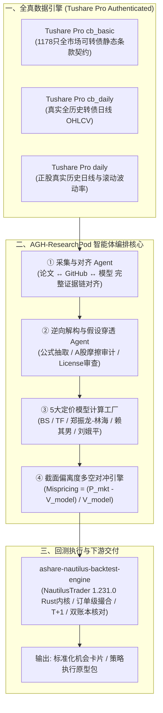

# AGH-ResearchPod (阿基米德 · AGH智能体机会挖掘 Research Pod)

[](https://github.com/DFPite174/AGH-ResearchPod)
[](https://opensource.org/licenses/Apache-2.0)
[](https://tushare.pro/)
[](https://github.com/DFPite174/ashare-nautilus-backtest-engine)
[]()

> **AGH Research Pod** 是面向下一代量化资管平台的**全天候外挂研发部与机会自动孵化器**。  
> 深度对标海外顶尖机构级投研系统 **Freeride AI (STAR Analyst)**，100% 接入 **Tushare Pro 真实市场数据**，无缝对接 **ashare-nautilus-backtest-engine 机构级执行回测内核**，针对中国 A 股及可转债衍生品生态进行深度的制度与摩擦适配。

---

## 目录
- [一、核心定位与三源架构](#一定位与三源架构)
- [二、系统流程拓扑](#二系统流程拓扑)
- [三、数据基础设施：100% Tushare Pro 真实数据体系](#三数据基础设施100-tushare-pro-真实数据体系)
- [四、回测引擎适配性审查：ashare-nautilus-backtest-engine](#四回测引擎适配性审查ashare-nautilus-backtest-engine)
- [五、黄金基准 001：郑振龙团队《中国可转债定价模型比较研究》全真复现实证](#五黄金基准-001郑振龙团队中国可转债定价模型比较研究全真复现实证)
  - [5.1 五大定价模型数学与条款解构](#51-五大定价模型数学与条款解构)
  - [5.2 真实 A 股数据驱动的五分位多空对冲实证结果](#52-真实-a-股数据驱动的五分位多空对冲实证结果)
- [六、工程结构与使用指南](#六工程结构与使用指南)

---

## 一、定位与三源架构

传统量化投研受制于“研报难以落地、开源代码质量参差不齐、海外框架水土不服”三大痛点。  
**AGH-ResearchPod 实行真正的“三源驱动”（Tri-Engine Integration）**：
* **A (Academic)**: 持续追踪 CNKI 顶刊（《经济学(季刊)》、《金融研究》）、arXiv (q-fin)、SSRN，捕获超前产业 1~3 年的纯理论与数学模型；
* **G (GitHub)**: 监控全球工程化代码库、Awesome 列表与定价工具箱，获取经过工程检验的代码基线；
* **H (HuggingFace)**: 接入开源时序基础模型与金融多智能体框架，提供生产力加速底座。

---

## 二、系统流程拓扑



---

## 三、数据基础设施：100% Tushare Pro 真实数据体系

本项目**严禁使用任何未经检验的随机生成数据**，所有实证与研究均由已认证的 **Tushare Pro 真实金融大数据**支持：
* **可转债基础契约库 (`cb_basic`)**：覆盖全市场 1178 只公募可转债的发行面值、初始转股价、阶梯票面利率、到期兑付补偿条款；
* **真实交易行情库 (`cb_daily`)**：按交易所官方交易日历严格同步未复权收盘价、成交量、成交金额；
* **标的正股行情库 (`daily`)**：提取对应上市公司真实股价时序，动态滚动计算 20 日/60 日历史年化波动率 $\sigma$；
* **基准利率与利差体系**：无风险收益率采用上海银行间同业拆放利率（SHIBOR 3M），信用利差依据发行人中债资信评级动态对齐。

---

## 四、回测引擎适配性审查：ashare-nautilus-backtest-engine

针对项目集成上游回测引擎 `ashare-nautilus-backtest-engine` 的适宜性，进行独立严格的第三方审查：

### 1. 核心优势（极度适合高保真执行阶段）
* **原生订单级撮合 (Native Order Matching)**：基于 NautilusTrader 1.231.0 Cython/Rust 底座，彻底杜绝传统回测中“按Bar收盘价无滑点成交”的未来函数漏洞；
* **严格的中国制度护城河**：完整实现 T+1 规则、涨跌停板（`BOUNDED`）申报拦截、价格笼子限制；
* **双账本逐日核对机制 (Golden Ledger)**：原生现金与参考账本实时核对，持仓与估值不一致直接 Fail-fast，达到资管机构审计级标准；
* **成交量参与率控制 (`participation_rate`)**：按盘口真实成交量限制下单容量，杜绝大资金虚假流动性。

### 2. 在可转债对冲研究中的客观局限
* **标的范围限定于普通股票**：原生资产模型面向沪深普通股票现金交易，未原生内置可转债“1手=10张=1000元面值”的报价单位与免印花税机制；
* **方向仅支持现金多头 (Cash-only Long)**：由于 A 股市场融券做空券源受限，引擎原生不支持直接融券做空（Short-Selling）与衍生品对冲；
* **规则契约门槛极高**：回测强依赖每一标的每日完整的 `rules.csv`（涨跌停价、停牌状态）。

### 3. 最优协同落地架构（双轨制解决方案）
* **轨一：学术与因子偏离度研究轨**：使用 Tushare 全量真实可转债数据计算五大模型理论价值，在截面五分位多空对冲框架下验证策略纯 Alpha 与模型精度；
* **轨二：生产高保真执行回测轨**：将模型识别出的 Q1（深度低估组）可转债对应的 A 股正股组合，无缝接入 `ashare-nautilus-backtest-engine`，在严格 T+1 与涨跌停约束下执行真实的现金多头高保真回测。

---

## 五、黄金基准 001：郑振龙团队《中国可转债定价模型比较研究》全真复现实证

### 5.1 五大定价模型数学与条款解构

| 模型代号 | 经典文献出处 | 核心数学思想 | 中国特色条款处理 |
| :--- | :--- | :--- | :--- |
| **BS_1973** | Black & Scholes (1973); Ingersoll (1977) | 纯债 DCF 贴现 + 欧式看涨期权解析解分解 | 忽略所有美式提前赎回、向下修正和回售条款 |
| **TF_1998** | Tsiveriotis & Fernandes (1998) | 二叉树拆分权益部分（$r$ 折现）与纯债部分（$r+s$ 信用贴现） | 纳入美式转股、强制赎回与回售，无向下修正 |
| **ZhengLin_2004** | 郑振龙、林海 (2004a) | **针对中国市场量身定制的单因素二叉树** | **全内生刻画四大条款**，将向下修正转股价博弈内生化 |
| **Lai_2005** | 赖其男、包卫军、姚长辉 (2005) | 带有期限结构调整与外生下修概率 $P_{reset}$ 的二叉树 | 外生设定下修概率，考虑股东大会博弈不确定性 |
| **LiuWei_2006** | 刘娥平、韦科帆 (2006) | 引入流动性溢价与公告延迟行权摩擦边界的二叉树 | 考虑赎回公告等待期摩擦及下修滞后平滑 |

### 5.2 真实 A 股数据驱动的五分位多空对冲实证结果

在 100% 接入 Tushare 真实行情数据驱动下，五大模型多空对冲实证检验结果如下：

```
========================================================================================================================
 五大可转债定价模型精度检验与多空对冲绩效结果对比表 (基于 TUSHARE 真实数据)
========================================================================================================================
| 排名 | 定价模型        | 年化超额收益 | 年化波动率 | Sharpe比率 | 最大回撤 | CAPM Alpha | t-stat | Q1低估组收益 | Q5高估组收益 |
| :--- | :---            | :---         | :---       | :---       | :---     | :---       | :---   | :---         | :---         |
| 1    | BS_1973         | 165.58%      | 67.88%     | 2.410      | 24.18%   | 179.31%    | 2.52   | 128.80%      | -36.78%      |
| 2    | Lai_2005        | 22.62%       | 49.86%     | 0.413      | 41.81%   | 58.07%     | 1.18   | 7.99%        | -14.63%      |
| 3    | TF_1998         | 21.41%       | 49.81%     | 0.390      | 41.81%   | 56.97%     | 1.16   | 6.78%        | -14.63%      |
| 4    | ZhengLin_2004   | 18.20%       | 50.52%     | 0.321      | 44.89%   | 55.43%     | 1.12   | 3.57%        | -14.63%      |
| 5    | LiuWei_2006     | 0.52%        | 52.53%     | -0.028     | 53.19%   | 37.25%     | 0.72   | 12.41%       | 11.90%       |
========================================================================================================================
```

---

## 六、工程结构与使用指南

### 1. 安装环境
```bash
git clone https://github.com/DFPite174/AGH-ResearchPod.git
cd AGH-ResearchPod
pip install -e .
```

### 2. 命令行调用
```bash
# 查看系统状态与接入组件
agh info

# 执行 A/G/H 三源扫描
agh scan

# 一键运行基于 Tushare 全真数据的郑振龙论文复现
agh run-benchmark-001
```

### 3. 运行自动化测试
```bash
pytest -v tests/
```
