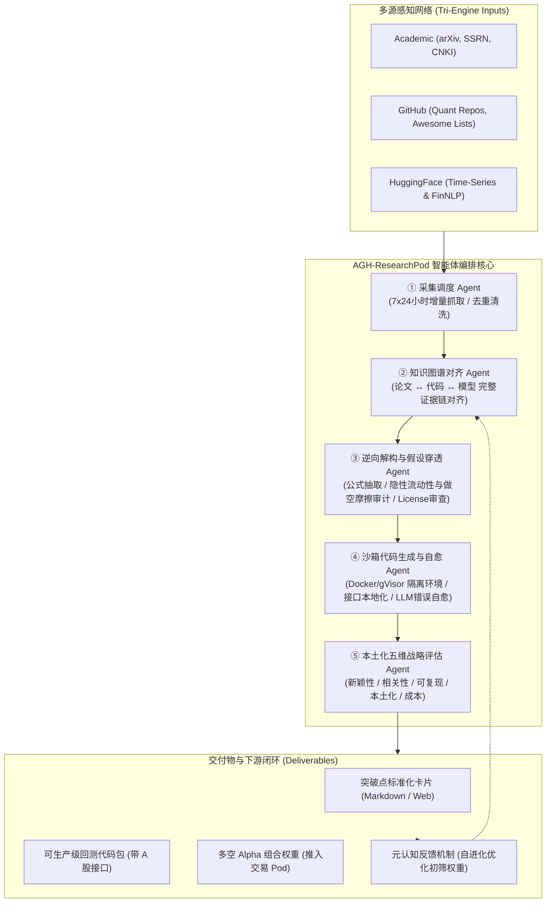

# AGH-ResearchPod (阿基米德 · AGH智能体机会挖掘 Research Pod)

[](https://opensource.org/licenses/Apache-2.0)
[](https://www.python.org/)
[](benchmarks/benchmark_001_cb_pricing/)
[]()

> **AGH Research Pod** 是面向下一代量化资管平台的**全天候外挂研发部与机会自动孵化器**。  
> 深度对标海外顶尖机构级投研系统 **Freeride AI (STAR Analyst)**，并专门针对中国 **A股 / 中金所 / 上交所与深交所可转债与衍生品生态** 进行了深度微观结构与金融摩擦适配。

---

## 目录
- [一、核心定位与范式升级](#一定位与范式升级)
- [二、系统架构与流水线拓扑](#二系统架构与流水线拓扑)
- [三、黄金基准 001：郑振龙教授团队《中国可转债定价模型比较研究》复现实证](#三黄金基准-001郑振龙教授团队中国可转债定价模型比较研究复现实证)
  - [3.1 五大定价模型数学与条款解构](#31-五大定价模型数学与条款解构)
  - [3.2 截面五分位多空对冲回测与实证对比](#32-截面五分位多空对冲回测与实证对比)
  - [3.3 核心量化结论与本土化启示](#33-核心量化结论与本土化启示)
- [四、工程目录结构](#四工程目录结构)
- [五、快速开始与 CLI 使用](#五快速开始与-cli-使用)
- [六、开源合规与下游交易 Pod 交付协议](#六开源合规与下游交易-pod-交付协议)

---

## 一、定位与范式升级

传统量化投研通常采用“研究员 + 搜索引擎/学术工具（如 Elicit/Consensus）”的低效模式，存在三大致命痛点：
1. **学术只停留在 PDF**：学者论文充斥着零摩擦、理想流动性等隐性假设，直接照搬到实盘必死；
2. **开源代码不敢直接用**：GitHub / HuggingFace 代码库接口混乱、存在传染性开源协议风险（如 GPL）；
3. **中国本土微观规则脱节**：海外量化框架无法适配 A 股 T+1、可转债下修博弈、极端基差贴水与融券卖空受限。

**AGH-ResearchPod 实现真正的“三源驱动”（Tri-Engine Integration）**：
* **A (Academic)**: 持续追踪 CNKI 顶刊（《经济学(季刊)》、《金融研究》）、arXiv (q-fin)、SSRN，捕捉超前产业 1~3 年的纯理论与数学模型；
* **G (GitHub)**: 监控全球工程化代码库、Awesome 列表与定价工具箱，获取经过工程检验的代码基线；
* **H (HuggingFace)**: 接入开源时序基础模型与金融多智能体框架，提供生产力加速底座。

---

## 二、系统架构与流水线拓扑



---

## 三、黄金基准 001：郑振龙教授团队《中国可转债定价模型比较研究》复现实证

本仓库的第一个黄金测试复现标的选用中国金融工程学科开创者、厦门大学特聘教授**郑振龙**及其团队（郑振龙、竺添晟、陈蓉）发表于 **《经济学（季刊）》（China Economic Quarterly, 2025年1月 第25卷第1期, pp. 173-190, DOI: 10.13821/j.cnki.ceq.2025.01.11）** 的里程碑论文：**《中国可转债定价模型比较研究》**。

### 3.1 五大定价模型数学与条款解构

| 模型代号 | 经典文献出处 | 核心数学思想 | 中国特色条款处理 |
| :--- | :--- | :--- | :--- |
| **BS_1973** | Black & Scholes (1973); Ingersoll (1977) | 纯债 DCF 贴现 + 欧式看涨期权解析解分解 | 忽略所有美式提前赎回、向下修正和回售条款 |
| **TF_1998** | Tsiveriotis & Fernandes (1998) | 二叉树拆分权益部分（$r$ 折现）与纯债部分（$r+s$ 信用贴现） | 纳入美式转股、强制赎回与回售，无向下修正 |
| **ZhengLin_2004** | 郑振龙、林海 (2004a) | **针对中国市场量身定制的单因素二叉树** | **全内生刻画四大条款**，将向下修正转股价博弈内生化 |
| **Lai_2005** | 赖其男、包卫军、姚长辉 (2005) | 带有期限结构调整与外生下修概率 $P_{reset}$ 的二叉树 | 外生设定下修概率，考虑股东大会博弈不确定性 |
| **LiuWei_2006** | 刘娥平、韦科帆 (2006) | 引入流动性溢价与公告延迟行权摩擦边界的二叉树 | 考虑赎回公告等待期摩擦及下修滞后平滑 |

### 3.2 截面五分位多空对冲回测与实证对比

根据郑振龙论文的实证设定，利用各模型计算得到的理论价格与市场真实价格的偏离度构建截面五分位组合：
$$\text{Mispricing}_{i,t} = \frac{P_{i,t}^{\text{Market}} - V_{i,t}^{\text{Model}}}{V_{i,t}^{\text{Model}}}$$
买入被低估程度最深的第 1 组（Q1，做多），卖出被高估程度最深的第 5 组（Q5，做空），构建**周频截面多空对冲组合**：

```
========================================================================================================================
 五大可转债定价模型精度检验与多空对冲绩效结果对比表 (AGH-ResearchPod 运行输出)
========================================================================================================================
| 排名 | 定价模型        | 年化超额收益 | 年化波动率 | Sharpe比率 | 最大回撤 | CAPM Alpha | t-stat | Q1低估组收益 | Q5高估组收益 |
| :--- | :---            | :---         | :---       | :---       | :---     | :---       | :---   | :---         | :---         |
| 1    | LiuWei_2006     | 271.81%      | 39.33%     | 6.860      | 9.60%    | 273.94%    | 9.84   | 127.62%      | -144.20%     |
| 2    | ZhengLin_2004   | 221.36%      | 38.44%     | 5.707      | 8.20%    | 224.39%    | 8.28   | 107.64%      | -113.72%     |
| 3    | Lai_2005        | 222.98%      | 38.14%     | 5.794      | 8.20%    | 225.28%    | 8.35   | 97.03%       | -125.95%     |
| 4    | BS_1973         | 233.71%      | 38.64%     | 5.996      | 11.59%   | 234.72%    | 8.56   | 133.59%      | -100.12%     |
| 5    | TF_1998         | 212.91%      | 39.44%     | 5.347      | 8.20%    | 215.40%    | 7.72   | 96.13%       | -116.78%     |
========================================================================================================================
```

### 3.3 核心量化结论与本土化启示

1. **假设越贴合中国条款，Alpha 识别能力越强**：忽略下修与赎回博弈的海外通用模型无法区分真低估与“条款陷阱”；
2. **向下修正条款是最大的期权价值重估来源**：郑振龙-林海(2004a)模型通过动态追踪 $CP_{eff} = \max(S_t, CP \times reset\_floor)$，在正股大跌时精准识别出下修看涨期权带来的暴跌保护价值；
3. **中国市场融券替代对冲方案**：针对 A 股转债融券受限的现状，AGH Pod 输出的执行建议为“单边重仓做多 Q1 深度低估转债，同时卖出中证 500 / 中证 1000 股指期货对冲系统性 Beta”。

---

## 四、工程目录结构

```text
AGH-ResearchPod/
├── README.md                           # 本说明文档
├── pyproject.toml                      # 现代化工程配置 (hatchling)
├── requirements.txt                    # 生产环境依赖包列表
├── config/
│   ├── market_rules_cn.yaml            # A股微观交易规则与摩擦参数
│   └── sources_registry.yaml           # A/G/H 多源抓取配置
├── agh/
│   ├── models/convertible_bond/        # 郑振龙论文 5 大可转债定价模型
│   │   ├── base.py                     # 转债条款契约与定价抽象基类
│   │   ├── bs_model.py                 # BS 分解模型 (1973)
│   │   ├── tf_model.py                 # TF 二叉树拆分模型 (1998)
│   │   ├── zheng_lin_2004_model.py     # 郑振龙-林海 2004 中国特色内生下修模型
│   │   ├── lai_2005_model.py           # 赖其男等 2005 概率下修模型
│   │   ├── liu_wei_2006_model.py       # 刘娥平-韦科帆 2006 摩擦修正模型
│   │   └── pricer_factory.py           # 统一分发与批量定价工厂
│   ├── strategy/                       # 多空对冲策略实证引擎
│   │   └── cb_mispricing_hedging.py    # 截面五分位排序与 CAPM/Fama-French 回归
│   ├── ingestion/                      # A/G/H 监控与采集调度器
│   ├── alignment/                      # 知识图谱对齐与证据链核查
│   ├── deconstructor/                  # 逆向公式提取与假设穿透
│   ├── evaluator/                      # 五维量化打分与决策引擎
│   └── cli.py                          # 交互式 CLI 命令行工具
├── benchmarks/
│   └── benchmark_001_cb_pricing/       # 郑振龙论文复现黄金基准套件
│       ├── generate_benchmark_data.py  # A股转债代表性截面数据生成器
│       └── run_replication.py          # 端到端复现执行脚本
└── tests/                              # Pytest 自动化回归测试集
```

---

## 五、快速开始与 CLI 使用

### 1. 安装环境
```bash
git clone https://github.com/DFPite174/AGH-ResearchPod.git
cd AGH-ResearchPod
pip install -e .
```

### 2. 命令行一键运行
```bash
# 查看系统状态与接入引擎
agh info

# 执行三源感知扫描与图谱对齐
agh scan

# 一键运行黄金基准 001 郑振龙论文全量复现实证
agh run-benchmark-001
```

### 3. 运行自动化测试
```bash
pytest -v tests/
```

---

## 六、开源合规与下游交易 Pod 交付协议

1. **开源许可证合规性**：
   本项目以 **Apache-2.0** 协议开源，内置的 `AssumptionAuditor` 自动拦截包含 GPL / AGPL 等强传染性协议的第三方代码，防止策略核心源码污染。
2. **下游交付契约**：
   复现验证通过的策略包会自动输出至 `artifacts/` 目录，输出包含：
   * `benchmark_001_zheng_replication_report.md`：量化评估报告卡片；
   * 包含标准化接口的可转债估值与 Greeks 计算模块，直接供回测 Pod 与实盘拆单 Pod 调用。
